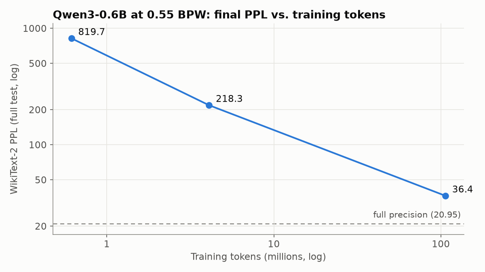

# little-bit

A from-scratch PyTorch implementation of **sub-1-bit LLM compression** via binarized low-rank factorization: [LittleBit](https://arxiv.org/abs/2506.13771) (NeurIPS 2025) and the Joint-ITQ initialization of [LittleBit-2](https://arxiv.org/abs/2603.00042) (ICML 2026). It also includes a distillation-loss fix for models with attention-sink activations, such as Qwen3.

**Headline result:** Qwen3-0.6B compressed to **0.55 bits per weight** reaches WikiText-2 perplexity **36.43 vs. 20.95** in full precision (**1.74×**). The transformer blocks shrink from ~840 MB to ~29 MB. Training took 66.5 hours on a single **GTX 1080 (8 GB)** with ~107M tokens.

→ **[Technical report](REPORT.md)**: method, ablations, results and limitations.

| | PPL (WikiText-2, full test) |
|---|---|
| OPT-125M, full precision | 27.66 |
| OPT-125M @ 0.55 BPW, LittleBit (Dual-SVID) | 199.08 |
| OPT-125M @ 0.55 BPW, LittleBit-2 (Joint-ITQ) | **132.65** |
| Qwen3-0.6B, full precision | 20.95 |
| Qwen3-0.6B @ 0.55 BPW, paper loss, 300 steps | 2,238 |
| Qwen3-0.6B @ 0.55 BPW, sink-aware loss, 300 steps | 820 |
| Qwen3-0.6B @ 0.55 BPW, sink-aware loss, 107M tokens | **36.43** |



## How it works

Every linear layer in the transformer blocks becomes two parallel paths, a primary path and a residual path, each of the form

```
Ŵ = diag(h) · sign(U) · diag(ℓ) · sign(V)ᵀ · diag(g)
```

with low-rank latent factors `U, V` binarized on the fly and FP16 scales `h, g, ℓ`. The rank is chosen to hit a target bits-per-weight. The model is then trained with quantization-aware knowledge distillation from the original model. See [REPORT.md](REPORT.md) for details.

## Quickstart

```bash
python -m venv .venv && source .venv/bin/activate
pip install -r requirements.txt
python -m pytest tests

# Small run (Apple Silicon / CPU / CUDA are picked automatically)
python train.py --model facebook/opt-125m --bpw 0.55 --init itq --steps 2000 --eval-every 250 --eval-batches 20

# Recipe for Qwen3 (attention-sink-aware loss, fits in 8 GB)
python train.py --model Qwen/Qwen3-0.6B --bpw 0.55 --init itq --kv-rank-mult 1 \
  --mse-skip-first 1 --mse-norm --grad-ckpt --seq-len 2048 --batch-size 1 --grad-accum 2 --lr 8e-5 \
  --steps 26000 --c4-mtokens 100 --wiki-repeat 4 --ckpt-every 250

# Evaluate a saved model
python eval_checkpoint.py runs/<run>/littlebit.pt
```

Main options of `train.py`:

| Flag | Meaning |
|---|---|
| `--bpw` | Target bits per weight for the transformer blocks |
| `--init {svid,rot,itq}` | Dual-SVID (LittleBit), random latent rotation, or Joint-ITQ (LittleBit-2) |
| `--mse-skip-first N`, `--mse-norm` | Sink-aware hidden-state loss (ours; see report §3) |
| `--kv-rank-mult` | Rank multiplier for GQA K/V projections (paper: 4) |
| `--c4-mtokens`, `--wiki-repeat` | Training mix: millions of C4 tokens + repeats of WikiText-2 train |
| `--grad-ckpt`, `--batch-size`, `--grad-accum` | Memory and throughput |
| `--ckpt-every` | Resumable checkpoints; an existing checkpoint is resumed automatically |
| `--train-embeddings` | Also train embeddings/`lm_head` (default: frozen and shared with the teacher) |

## Layout

```
littlebit/layer.py      LittleBitLinear, SmoothSign, Dual-SVID, Joint-ITQ, rank ↔ BPW
littlebit/convert.py    swap nn.Linear → LittleBitLinear, BPW / size report
littlebit/data.py       WikiText-2 + cached C4 token streams
littlebit/evaluate.py   chunked perplexity, generation
train.py                QAT with knowledge distillation (KL + hidden-state MSE)
eval_checkpoint.py      reload a trained model, report PPL and samples
scripts/                analysis (attention sink, init comparison, teacher PPL), figures, launch scripts
results/                logs of every run in the report, analysis tables, figures
tests/                  unit tests (paper's worked BPW examples, forward equivalence, ITQ invariance, …)
```

## Status and limitations

This is research code: single runs, perplexity-only evaluation, and no bit-packed inference kernel yet. Checkpoints store FP32 latents, and the reported sizes come from the storage formula. See [REPORT.md §5](REPORT.md#5-limitations).

## Credits

The method is by Banseok Lee, Dongkyu Kim, Youngcheon You and Youngmin Kim (Samsung Research). This repository is an independent re-implementation from the papers and is not affiliated with the authors. Official code: [SamsungLabs/LittleBit](https://github.com/SamsungLabs/LittleBit).

## License

MIT, for this implementation. Models and datasets keep their own licenses.
