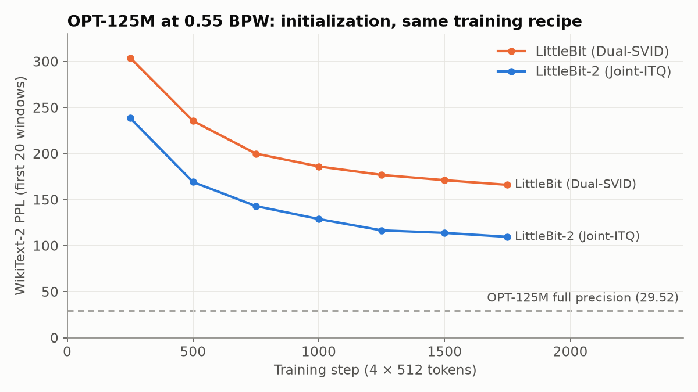
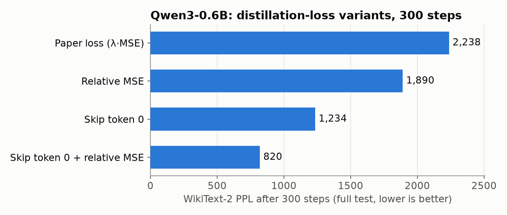
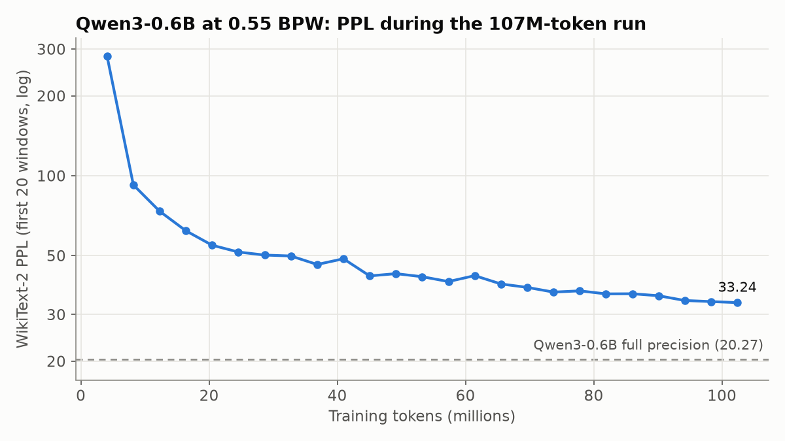

# LittleBit and LittleBit-2 on small models: a reproduction, and a fix for attention-sink activations in Qwen3

**Martin Giachetti** · October 2026 · code and logs: this repository

## Summary

We re-implemented sub-1-bit LLM compression via binarized low-rank factorization — **LittleBit** (Lee et al., NeurIPS 2025, [arXiv:2506.13771](https://arxiv.org/abs/2506.13771)) and its initialization upgrade **LittleBit-2** (Lee & Kim, ICML 2026, [arXiv:2603.00042](https://arxiv.org/abs/2603.00042)) — from the papers, and evaluated it on two small models at **0.55 bits per weight** using a single consumer GPU (GTX 1080, 8 GB).

- **LittleBit-2's Joint-ITQ initialization reproduces.** On OPT-125M, with an identical training recipe, it lowers final WikiText-2 perplexity from 199.1 to **132.7 (−33%)** and converges faster from the first evaluation.
- **Qwen3-0.6B breaks the paper's distillation loss.** Its residual stream carries a ~7,000-valued "attention sink" activation on token 0 (dimension 35), written by block 2's MLP. It holds up to 99.8% of hidden-state energy, so the paper's hidden-state MSE term is dominated by a single scalar. **Excluding position 0 from the MSE and normalizing it per layer** lowers perplexity **2.7×** after 300 steps (2,238 → 820).
- **With that fix and ~107M training tokens, Qwen3-0.6B at 0.55 BPW reaches WikiText-2 PPL 36.43 vs. 20.95 in full precision (1.74×).** The paper reports 1.60–1.91× at the same bit-width on models 2–12× larger trained on ~10× more tokens. The transformer blocks shrink from ~840 MB (BF16) to **~29 MB**; the whole model from ~1.1 GB to ~326 MB, because the FP16 embedding table dominates.

All numbers come from single runs (no error bars). The comparison to the papers is across different models and token budgets.


## 1. Method (as implemented)

Each `nn.Linear` inside the transformer blocks is replaced by two parallel binarized low-rank paths, a primary path and a residual path (LittleBit Eqs. 4, 9, 10):

```
Ŵ = diag(h)·sign(U)·diag(ℓ)·sign(V)ᵀ·diag(g)   per path,   W ≈ Ŵ_pri + Ŵ_res
Y = ((((X ⊙ g) · sign(V)) ⊙ ℓ) · sign(U)ᵀ) ⊙ h   (Ŵ is never materialized)
```

`U, V` are full-precision latent factors that are binarized in the forward pass. `h, g, ℓ` are row, column and latent scales. Storage per layer is `2·[r(d_in+d_out) + 16(d_in+d_out) + 16r]` bits, and the rank `r` is solved from the target BPW (LittleBit Appendix D; the unit tests check the paper's worked examples, r = 546 → 0.5498 BPW and r = 133 → 0.0999 BPW).

| Component | Implementation |
|---|---|
| Gradient through `sign` | SmoothSign: forward `sign(x)`, backward `d/dx tanh(100x)` |
| LittleBit initialization | Dual-SVID: truncated SVD with √Σ split evenly; `h, ℓ_u` and `g, ℓ_v` from rank-1 SVDs of \|U\|, \|V\|; `ℓ = ℓ_u ⊙ ℓ_v` |
| LittleBit-2 initialization | Joint-ITQ: stack `Z = [U; V]`; for 50 iterations, `B = sign(ZR)` and `R` = orthogonal Procrustes solution (SVD of `BᵀZ`); then `U ← UR, V ← VR` (W unchanged) and Dual-SVID scale extraction |
| Residual path | Same structure and rank, initialized on `W − Ŵ_pri` |
| Training | QAT with knowledge distillation: `L = KL(teacher ‖ student) + λ · MSE(hidden states)`, λ = 10; Adam, cosine decay, 2% warm-up, gradient clipping at 1.0 |
| Kept in full precision | Embeddings and `lm_head`, plus norms and biases. Embeddings were trainable in the OPT runs (§2) and frozen and shared with the teacher in the Qwen runs (§3), to fit 8 GB. Norms and biases are always trainable |

**Differences from the papers.** (1) In the Qwen runs, embeddings and `lm_head` are frozen; the papers do not say whether they train them. (2) The teacher runs in FP32 because Pascal GPUs have no fast FP16/BF16. (3) Our K/V rank multiplier for GQA models is ×1, not the paper's ×4: on Qwen3-0.6B, K/V are 13% of each block, and ×4 would push the real bit-width from 0.55 to roughly 1.0 BPW. (4) The two loss changes in §3.2 are ours.

## 2. LittleBit vs. LittleBit-2 initialization (OPT-125M)

**Reconstruction before training.** Mean relative error ‖W − Ŵ‖/‖W‖ over 18 linear layers (blocks 0, 6, 11; `scripts/compare_init.py`):

| BPW | Dual-SVID (LittleBit) | random rotation | Joint-ITQ (LittleBit-2) |
|---|---|---|---|
| 1.0 | 0.754 | 0.701 | **0.623** |
| 0.55 | 0.829 | 0.791 | **0.749** |
| 0.3 | 0.890 | 0.863 | **0.842** |
| 0.1 | 0.959 | 0.954 | **0.951** |

The ordering matches LittleBit-2's ablation. The gap narrows at low bit-widths, where OPT-125M's ranks are tiny (r ≈ 3–15 at 0.1 BPW).

**After training.** 0.55 BPW, 2,000 steps × 4 × 512 tokens (4.1M tokens, WikiText-2 train only), lr 1.2e-4, Apple M4 (MPS):

| Initialization | PPL at init | PPL, final (full test) | vs. FP (27.66) |
|---|---|---|---|
| Dual-SVID (LittleBit) | 29,646 | 199.08 | 7.2× |
| **Joint-ITQ (LittleBit-2)** | **5,552** | **132.65** | **4.8×** |



The pre-training reconstruction gap (0.829 vs. 0.749) turns into a much larger gap after QAT. Joint-ITQ at step 750 already matches Dual-SVID at step 1,750. This is consistent with LittleBit-2's claim of a more stable optimization ("sign flipping"). We did not measure sign flips directly.

## 3. Qwen3-0.6B

### 3.1 The attention sink dominates the distillation loss

Profiling the teacher's hidden states on WikiText-2 (`scripts/attention_sink.py`, full table in [`results/qwen3_attention_sink.md`](results/qwen3_attention_sink.md)):

| Hidden state | max \|x\| | RMS | energy at token 0 |
|---|---|---|---|
| after block 1 | 7.7 | 0.33 | 0.3% |
| after block 2 | **7,155.9** | 9.28 | **99.8%** |
| after block 13 | 7,132.2 | 9.37 | 97.2% |
| after block 26 | 6,917.7 | 20.66 | 18.9% |
| final (post-norm) | 102.4 | 3.76 | 0.1% |

Block 2's MLP writes +6,543 into dimension 35 of the first token (its attention adds 4.2). The value persists across the residual stream until the final norm. This matches the known "massive activations" / attention-sink phenomenon. Consequences for LittleBit's loss:

- The absolute hidden-state MSE is ~124 at initialization versus a KL of ~17.5. With λ = 10, the MSE outweighs the KL ~70:1, and nearly all of it is one scalar per sequence.
- Normalizing the MSE by the teacher's energy alone does not fix this, because the normalizer is dominated by the same spike: it acts as a smaller λ.
- Keeping block 2's MLP in full precision **did not** help at initialization (PPL 5.0e7 – 1.6e8 versus 1.1e8, while costing +0.11 to +0.33 BPW), so we did not pursue mixed precision.

### 3.2 Loss fix

Two flags in `train.py`:

- `--mse-skip-first 1`: drop position 0 from the hidden-state MSE. The logit KL still covers every position, including token 0.
- `--mse-norm`: divide each layer's MSE by the teacher's mean squared activation, so layers with large residual norms do not dominate.

300-step runs (0.55 BPW, Joint-ITQ, 4 × 512 tokens/step, lr 8e-5, GTX 1080):

| Loss | KL at step 280 | PPL (full test) |
|---|---|---|
| Paper (λ · absolute MSE) | 4.75 | 2,238 |
| relative MSE | 4.55 | 1,890 |
| skip token 0 | 4.11 | 1,234 |
| **skip token 0 + relative MSE** | **3.53** | **820** |



These are short runs from a single seed. The ranking held in every longer run we did, but we did not run the paper loss for longer.

### 3.3 Scaling the training data

| Run | Data | Steps × tokens/step | Tokens | PPL (full test) | vs. FP (20.95) |
|---|---|---|---|---|---|
| A | WikiText-2 | 300 × 2,048 | 0.6M | 819.67 | 39× |
| B | WikiText-2 | 2,000 × 2,048 | 4.1M | 218.35 | 10.4× |
| **C** | **C4 (100M) + 4 × WikiText-2** | **26,000 × 4,096** | **106.5M** | **36.43** | **1.74×** |

All three use Joint-ITQ, skip-token-0 + relative MSE, and lr 8e-5 with cosine decay. A and B use 512-token sequences; C uses 2,048 tokens, matching the paper and the evaluation. Run C took **66.5 hours on a GTX 1080** (9.2 s/step, 6.83 GB peak, gradient checkpointing, logits computed in 128-token chunks). It checkpointed every 250 steps but never needed to resume.



Perplexity on the first 20 evaluation windows was still falling at the end (33.86 → 33.55 → 33.24 over the last three evaluations), so more data should help further.

**Samples (greedy, repetition penalty 1.1)**, run C:

> *Leonardo da Vinci painted the Mona Lisa. The Mona Lisa is* a painting of a woman who has been in the world for 10 years, and she is a woman who has lived in the world for many years. She is also known as the Mona Lisa. […]

> *Turing is called the father of computer science. Computer science is* a field that has been used in many ways, but it's not always the case. It's also known as the "computer science" and is often referred to as the "computer science" or "computer science". […]

The output is grammatical and topical but repetitive and factually empty. This matches the papers' qualitative description at ~2–3× PPL degradation. Run B, by contrast, produced "a very beautiful, beautiful and beautiful, beautiful…" degenerate text.

### 3.4 Size

| | Parameters | Storage |
|---|---|---|
| Transformer blocks, BF16 | 440.4M | ~840 MB |
| Transformer blocks, LittleBit 0.5495 BPW | 440.4M | **~28.9 MB** |
| Embeddings / `lm_head` (tied) + norms, FP16 | 155.6M | ~297 MB |
| **Whole model, LittleBit** | | **~326 MB** (vs. ~1.1 GB BF16) |

At this scale the FP16 embedding table dominates the compressed model, as both papers note for large vocabularies (Qwen3: 151,936 tokens). Sizes are computed from the storage formula. We have not yet implemented bit-packing, so checkpoints still store FP32 latents.

## 4. Context: the papers at 0.55 BPW

| Model | Method | Training tokens | PPL | FP | Ratio |
|---|---|---|---|---|---|
| OPT-1.3B | LittleBit (paper) | ~1B | 23.35 | 14.62 | 1.60× |
| Llama-2-7B | LittleBit (paper) | ~1B | 10.47 | 5.47 | 1.91× |
| Llama-2-7B | LittleBit-2 (paper) | ~1B | 9.65 | 5.47 | 1.76× |
| **Qwen3-0.6B** | **LittleBit-2 + sink-aware loss (ours)** | **0.1B** | **36.43** | **20.95** | **1.74×** |

Ratios are the most comparable quantity across models, but they still mix model families, sizes and data budgets. Qwen3-0.6B is also the post-trained (hybrid-thinking) checkpoint, not a base model.

## 5. Limitations

- **Single runs, no error bars, one seed.** Learning rates were not swept (the paper sweeps 4e-5 to 2.4e-4); 8e-5 and 1.2e-4 were chosen once.
- **Perplexity only.** Evaluation is WikiText-2 perplexity on 2,048-token windows. We did not run the zero-shot reasoning benchmarks (ARC, HellaSwag, PIQA, WinoGrande, BoolQ, OBQA) that the papers report.
- **Noisy intermediate evaluations.** Mid-training numbers use the first 20 test windows and run 1.1–1.35× below the full-test number (1.10× in run C, 1.2–1.35× in the shorter runs). Only "final" numbers are full-test.
- **Training data.** We used ~0.1B tokens versus the papers' ~1B.
- **The loss fix is tuned on Qwen3-0.6B.** We have not verified that it is neutral on models without attention sinks, or how it interacts with the paper's λ.
- **Memory pressure.** Run B hit the 8 GB limit and the CUDA allocator logged ~4,000 retry warnings; training completed normally. Run C used smaller logit chunks and did not.
- **No packed inference yet.** There are no latency measurements.

## 6. Reproducing

```bash
pip install -r requirements.txt     # Pascal GPUs: install torch from the cu126 index
python -m pytest tests

# OPT-125M, LittleBit vs LittleBit-2 (§2)
python train.py --model facebook/opt-125m --bpw 0.55 --init svid --steps 2000 --eval-every 250 --eval-batches 20 --train-embeddings
python train.py --model facebook/opt-125m --bpw 0.55 --init itq  --steps 2000 --eval-every 250 --eval-batches 20 --train-embeddings

# Qwen3-0.6B run C (§3.3) — see scripts/qwen_c4.sh (auto-resume wrapper)
python train.py --model Qwen/Qwen3-0.6B --init itq --bpw 0.55 --kv-rank-mult 1 \
  --grad-ckpt --mse-norm --mse-skip-first 1 --seq-len 2048 --batch-size 1 --grad-accum 2 \
  --lr 8e-5 --steps 26000 --c4-mtokens 100 --wiki-repeat 4 --eval-every 1000 --eval-batches 20 \
  --ckpt-every 250 --tag c4

# Re-evaluate a saved model; analysis scripts; figures
python eval_checkpoint.py runs/Qwen3-0.6B-bpw0.55-itq-msenorm-skip1-c4/littlebit.pt
python scripts/teacher_ppl.py facebook/opt-125m Qwen/Qwen3-0.6B
python scripts/compare_init.py && python scripts/attention_sink.py && python scripts/make_figures.py
```

Reloading the run C checkpoint with `eval_checkpoint.py` reproduces PPL 36.43 and the samples above exactly. Training logs for every run cited here are in [`results/logs/`](results/logs/), with progress bars and allocator warnings stripped.

## 7. Next steps

1. **More tokens.** The curve was still descending at 107M. We estimate ~1B tokens takes 1–2 days on a single A100, H100 or RTX 5090 with BF16, versus ~25 days on the GTX 1080.
2. **Non-uniform rank allocation.** Allocate the bit budget by per-layer sensitivity or spectral decay, which both papers list as future work.
3. **Scale up.** Move to a 4–9B model (single large GPU), then to ~27–32B (multi-GPU, FSDP).
4. **Bit-packing and a packed inference kernel**, to report real memory and latency.
5. **Zero-shot benchmarks**, to complement perplexity.

## References

- B. Lee, D. Kim, Y. You, Y. Kim. *LittleBit: Ultra Low-Bit Quantization via Latent Factorization.* NeurIPS 2025. [arXiv:2506.13771](https://arxiv.org/abs/2506.13771)
- B. Lee, Y. Kim. *LittleBit-2: Maximizing the Spectral Energy Gain in Sub-1-Bit LLMs via Latent Geometry Alignment.* ICML 2026. [arXiv:2603.00042](https://arxiv.org/abs/2603.00042)
- M. Sun, X. Chen, J. Z. Kolter, Z. Liu. *Massive Activations in Large Language Models.* 2024. [arXiv:2402.17762](https://arxiv.org/abs/2402.17762)
- G. Xiao, Y. Tian, B. Chen, S. Han, M. Lewis. *Efficient Streaming Language Models with Attention Sinks.* ICLR 2024. [arXiv:2309.17453](https://arxiv.org/abs/2309.17453)
